


**Suriyaprakash Palanisamy** · Senior Software Engineer 
Backend · Cloud · ML platforms · AI-driven development

<a href="https://www.linkedin.com/in/suriyaprakashp/">LinkedIn</a> ·
<a href="https://stackoverflow.com/users/10440572/suriya-prakash">Stack Overflow</a> ·
<a href="https://hub.docker.com/u/suriya4code">Docker Hub</a> ·
<a href="mailto:suriya4code@gmail.com">suriya4code@gmail.com</a>

 


> I'm a senior software engineer with 10+ years across finance, healthcare, retail, pharma and insurance. Today I build FastAPI microservices on AWS EKS/ECS that serve machine-learning forecasting models at Freddie Mac, after working on an event-driven platform of 50+ AWS microservices at Capital One. I've led backend teams at Freddie Mac and Humana, and on my own time I ship things like **PangoLock**, a zero-knowledge AES-256-GCM vault for macOS, working AI-driven with Claude Code and MCP.

 

<a href="https://github.com/suriya4code/PangoLock"></a>

<a href="https://github.com/suriya4code/RAG_PDF_Genie_with_Local_LLM"></a>
<a href="https://github.com/suriya4code/tesseract-ocr"></a>
<a href="https://github.com/suriya4code/express_js_prometheus"></a>
<a href="https://github.com/suriya4code/python-microservice"></a>

OCR trilogy: <a href="https://github.com/suriya4code/tesseract-ocr">tesseract-ocr</a> · <a href="https://github.com/suriya4code/tesseract-flask">tesseract-flask</a> · <a href="https://github.com/suriya4code/tesseract-pillow">tesseract-pillow</a> &nbsp;|&nbsp; Images: <a href="https://hub.docker.com/r/suriya4code/python-flask-microservice">python-flask-microservice</a> · <a href="https://hub.docker.com/r/suriya4code/flask-ocr">flask-ocr</a>

 


<b>FastAPI patterns</b> <a href="https://github.com/suriya4code/fastapi_practices">fastapi_practices</a> · <a href="https://github.com/suriya4code/fastapi_sql_aws_base">fastapi_sql_aws_base</a> &nbsp;·&nbsp; <b>Frontend &amp; 3D</b> <a href="https://github.com/suriya4code/Babylon_Vue">Babylon_Vue</a> · <a href="https://github.com/suriya4code/react-basics-rejuvenation">react-basics-rejuvenation</a> · <a href="https://github.com/suriya4code/AngularInMemoryCompanyAdmin">AngularInMemoryCompanyAdmin</a> <b>Containers</b> <a href="https://github.com/suriya4code/flask_mongo_dockerized">flask_mongo_dockerized</a> · <a href="https://github.com/suriya4code/heroku_deploy_flask">heroku_deploy_flask</a> &nbsp;·&nbsp; <b>DSA galaxy</b> <a href="https://github.com/suriya4code/dsa_algo">dsa_algo</a> · <a href="https://github.com/suriya4code/blind_leetcode_python">blind_leetcode_python</a> &nbsp;·&nbsp; <b>Tools</b> <a href="https://github.com/suriya4code/github-stats">github-stats</a>

 

 


 


<a href="https://www.linkedin.com/in/suriyaprakashp/"></a>
<a href="https://stackoverflow.com/users/10440572/suriya-prakash"></a>
<a href="https://hub.docker.com/u/suriya4code"></a>
<a href="mailto:suriya4code@gmail.com"></a>

<b>Plain-text summary</b> (no animation)

### Suriyaprakash Palanisamy · Senior Software Engineer
Backend · Cloud · ML platforms · AI-driven development · McLean, VA

**In numbers:** 10+ years across the full SDLC · a 50+ AWS microservice platform I built and supported · 5 domains (finance, healthcare, retail, pharma, insurance) · refactored a 3,000+ line Python backend to ~1,000 lines with OOP for +20% performance · PyTest coverage kept above 85% on new code · led backend teams at Freddie Mac and Humana, and API development at CVS Health.

**Experience**
- **Jul 2026 – now · Freddie Mac** (finance, ML forecasting): rejoined; FastAPI microservices on AWS EKS/ECS serving ML forecasting models.
- **May 2025 – Jul 2026 · Capital One** (finance, credit cards): 50+ AWS microservice platform; event-driven serverless pipeline (EventBridge → Lambda → DynamoDB Streams → Step Functions → Glue/Spark); React/TS + Python; Vitest/RTL, Playwright BDD, feature-flagged rollouts.
- **Jan 2023 – May 2025 · Freddie Mac** (finance, ML forecasting): led the backend team; 3000 → 1000 line refactor (+20% performance); >85% coverage; Tableau deployment from PoC to production; built a local RAG system.
- **Apr 2022 – Jan 2023 · Agero**: FastAPI on AWS Lambda from scratch; S3 events → EventBridge → Lambda → MongoDB data sync; GitHub Actions CI/CD; React job dashboard.
- **May 2019 – Apr 2022 · Humana** (healthcare, specialty pharmacy): led the backend agile team; Tesseract OCR services in Flask integrated with .NET apps; Django; React.
- **Jun 2018 – May 2019 · McKesson** (pharma SaaS): Flask + MS SQL; Angular + C# Web API; Express/Node portal with TDD.
- **Sep 2017 – May 2018 · Woolworths, Sydney** (retail): ASP.NET/C# N-tier; Azure App Insights monitoring; Sev-1 incident response.
- **Jan 2016 – Aug 2017 · CVS Health** (pharmacy apps): led API development; AngularJS SPA from scratch on Web API + SQL Server.
- **2015 · Anna University**: BE Mechanical Engineering. From gears to graphs.

**Featured projects**
- [PangoLock](https://github.com/suriya4code/PangoLock): zero-knowledge folder vault for macOS (Swift/SwiftUI, macOS 13+, MIT, v0.2.1). AES-256-GCM with per-item keys (HKDF-SHA256), master key from PBKDF2-HMAC-SHA256 × 210,000, zero-knowledge verifier, Keychain + Touch ID, verify-before-delete, atomic writes, crash-window tests, 87 XCTest tests, CI on macOS, a written threat model, recovery key, portable lockers, encrypted sharing.
- [RAG PDF Genie](https://github.com/suriya4code/RAG_PDF_Genie_with_Local_LLM): ask a 115-page IRS PDF questions with a fully local LLM (LangChain, Ollama `llama3.2` + `nomic-embed-text`, ChromaDB, Streamlit, multi-query retriever). No API keys; the document never leaves the machine.
- OCR trilogy, [tesseract-ocr](https://github.com/suriya4code/tesseract-ocr) → [tesseract-flask](https://github.com/suriya4code/tesseract-flask) → [tesseract-pillow](https://github.com/suriya4code/tesseract-pillow): one OCR engine, three deployments (FastAPI on Heroku → Flask-RESTX on Docker Hub → Flask web UI with Heroku + Azure CD).
- [Express observability lab](https://github.com/suriya4code/express_js_prometheus): Express CRUD API with prom-client (request counter + latency histogram by method/route/status) and winston-loki logs; Prometheus, Grafana and Loki via Docker Compose.
- [Containers & Kubernetes](https://github.com/suriya4code/python-microservice): Flask API, 5 replicas behind a LoadBalancer Service on Minikube; Docker Hub images `suriya4code/python-flask-microservice` and `suriya4code/flask-ocr`.

**Stack:** Python, C#/.NET, JavaScript, TypeScript, Swift, Java, Bash, SQL · FastAPI, Flask/Flask-RESTX, .NET Web API/Core, Node/Express, Django · React, Angular/AngularJS, Vue, Redux, SwiftUI · AWS (Lambda, Step Functions, DynamoDB, EventBridge, S3, Glue/Spark, EKS/ECS), Azure, Heroku · GitHub Actions, Docker, Kubernetes, Jenkins · MS SQL Server, MongoDB, PostgreSQL, Oracle, Redshift, DynamoDB, Tableau, pandas/NumPy · PyTest, Playwright BDD, Vitest/RTL, XCTest, TDD · Prometheus, Grafana, Loki, CloudWatch, Azure App Insights · Claude Code, MCP, Copilot, local RAG, Tesseract OCR.

**Certifications:** Anthropic: Claude Code in Action, Introduction to Model Context Protocol, Claude 101 (Aug 2026). Microsoft: AZ-204 Azure Developer Associate, AI-900, AZ-900.

**Contact:** [LinkedIn](https://www.linkedin.com/in/suriyaprakashp/) · [Stack Overflow](https://stackoverflow.com/users/10440572/suriya-prakash) · [Docker Hub](https://hub.docker.com/u/suriya4code) · [suriya4code@gmail.com](mailto:suriya4code@gmail.com)

Every panel is a self-hosted SVG generated from code: pre-computed ASCII 3D, SMIL and CSS motion, no JavaScript, no external images.

