<b>Suriyaprakash Palanisamy</b> · Senior Software Engineer 
Backend · Cloud · ML platforms · AI-driven development 
10+ years across the full SDLC. Now building FastAPI microservices on AWS EKS/ECS that serve ML forecasting models at Freddie Mac (McLean, VA). Mechanical engineer by degree: from gears to graphs.

<a href="https://www.linkedin.com/in/suriyaprakashp/">LinkedIn</a> ·
<a href="https://stackoverflow.com/users/10440572/suriya-prakash">Stack Overflow</a> ·
<a href="https://hub.docker.com/u/suriya4code">Docker Hub</a> ·
<a href="mailto:suriya4code@gmail.com">suriya4code@gmail.com</a>

 

 

 

<a href="https://github.com/suriya4code/PangoLock"><b>PangoLock</b></a> · Swift / SwiftUI · macOS 13+ · MIT · v0.2.1 (pre-1.0) · verify-before-delete, atomic writes, crash-window tests, recovery key, portable lockers, encrypted sharing

 

<a href="https://github.com/suriya4code/RAG_PDF_Genie_with_Local_LLM"><b>RAG PDF Genie</b></a> · Python · LangChain · Ollama (llama3.2 + nomic-embed-text) · ChromaDB · Streamlit · multi-query retriever, grounded prompt

 

<b>OCR trilogy</b>: <a href="https://github.com/suriya4code/tesseract-ocr">tesseract-ocr</a> (2020) → <a href="https://github.com/suriya4code/tesseract-flask">tesseract-flask</a> (2021) → <a href="https://github.com/suriya4code/tesseract-pillow">tesseract-pillow</a> (2022) · <b>Observability</b>: <a href="https://github.com/suriya4code/express_js_prometheus">express_js_prometheus</a>

 

<a href="https://github.com/suriya4code/python-microservice"><b>python-microservice</b></a> · Docker Hub: <a href="https://hub.docker.com/r/suriya4code/python-flask-microservice">python-flask-microservice</a> · <a href="https://hub.docker.com/r/suriya4code/flask-ocr">flask-ocr</a>

 

<b>FastAPI patterns</b> <a href="https://github.com/suriya4code/fastapi_practices">fastapi_practices</a> · <a href="https://github.com/suriya4code/fastapi_sql_aws_base">fastapi_sql_aws_base</a> 
<b>Frontend &amp; 3D</b> <a href="https://github.com/suriya4code/Babylon_Vue">Babylon_Vue</a> · <a href="https://github.com/suriya4code/react-basics-rejuvenation">react-basics-rejuvenation</a> · <a href="https://github.com/suriya4code/AngularInMemoryCompanyAdmin">AngularInMemoryCompanyAdmin</a> 
<b>Containers</b> <a href="https://github.com/suriya4code/flask_mongo_dockerized">flask_mongo_dockerized</a> · <a href="https://github.com/suriya4code/heroku_deploy_flask">heroku_deploy_flask</a> 
<b>DSA galaxy</b> <a href="https://github.com/suriya4code/dsa_algo">dsa_algo</a> · <a href="https://github.com/suriya4code/blind_leetcode_python">blind_leetcode_python</a> · <b>Tools</b> <a href="https://github.com/suriya4code/github-stats">github-stats</a>

 

 

 

<b>Plain-text version</b> (the whole drawing set, for screen readers and quick scanning)

### Suriyaprakash Palanisamy
Senior Software Engineer · Backend · Cloud · ML platforms · AI-driven development · McLean, VA

**Now:** senior backend engineer on an ML forecasting platform at Freddie Mac (since Jul 2026), building FastAPI microservices on AWS EKS/ECS that serve machine-learning models for large-scale forecasting.

**Signature numbers**
- 10+ years across the full software development life cycle
- Contributed to a platform of 50+ AWS microservices
- Refactored a >3,000-line Python backend to ~1,000 lines with OOP, +20% performance
- PyTest coverage kept above 85% for all new code
- 5 domains: finance, healthcare, retail, pharma, insurance
- Led backend teams (Freddie Mac 2023–25, Humana 2019–22) and led API development at CVS Health

**Experience**
| When | Where | Domain | Highlights |
|---|---|---|---|
| Jul 2026 – now | Freddie Mac | Finance · ML forecasting | Rejoined; FastAPI microservices on AWS EKS/ECS serving ML forecasting models |
| May 2025 – Jul 2026 | Capital One | Finance · card portfolio decisioning | 50+ AWS microservice platform; event-driven serverless pipeline (EventBridge → Lambda → DynamoDB Streams → Step Functions → Glue/Spark); React/TS + Python; Vitest/RTL, Playwright BDD, feature-flagged rollouts |
| Jan 2023 – May 2025 | Freddie Mac | Finance · ML forecasting | Led the backend team; 3,000 → 1,000-line refactor (+20% perf); >85% coverage; Tableau deployment PoC → production; built a local RAG system |
| Apr 2022 – Jan 2023 | Agero | Serverless data sync | FastAPI on AWS Lambda from scratch; S3 events → EventBridge → Lambda → MongoDB data sync; GitHub Actions CI/CD; React job dashboard |
| May 2019 – Apr 2022 | Humana | Healthcare · specialty pharmacy | Led the backend agile team; Tesseract OCR services in Flask integrated with .NET apps; Django; React |
| Jun 2018 – May 2019 | McKesson | Pharma SaaS | Flask + MS SQL; Angular + C# Web API; Express/Node portal with TDD |
| Sep 2017 – May 2018 | Woolworths (Sydney) | Retail | ASP.NET/C# N-tier; Azure App Insights monitoring; Sev-1 incident response |
| Jan 2016 – Aug 2017 | CVS Health | Pharmacy apps | Led API development; AngularJS SPA from scratch on Web API + SQL Server |
| 2015 | Anna University | BE Mechanical Engineering | The origin story: from gears to graphs |

**Featured projects**
- [PangoLock](https://github.com/suriya4code/PangoLock): zero-knowledge folder vault for macOS (Swift/SwiftUI). AES-256-GCM with per-item keys (HKDF-SHA256), master key from PBKDF2-HMAC-SHA256 × 210,000, zero-knowledge verifier, Keychain + Touch ID, verify-before-delete, atomic writes, crash-window tests, 87 XCTest tests, CI on macOS, written threat model. MIT, v0.2.1 (pre-1.0).
- [RAG PDF Genie](https://github.com/suriya4code/RAG_PDF_Genie_with_Local_LLM): ask a 115-page IRS PDF questions with a fully local LLM (LangChain, Ollama llama3.2 + nomic-embed-text, ChromaDB, Streamlit). No API keys; the document never leaves the machine.
- OCR trilogy: one OCR engine, three deployments: [tesseract-ocr](https://github.com/suriya4code/tesseract-ocr) (FastAPI on Heroku, 2020) → [tesseract-flask](https://github.com/suriya4code/tesseract-flask) (Flask-RESTX on Docker Hub, 2021) → [tesseract-pillow](https://github.com/suriya4code/tesseract-pillow) (Flask web UI with Heroku + Azure CD, 2022).
- [Express observability lab](https://github.com/suriya4code/express_js_prometheus): Express CRUD API with prom-client (request counter + latency histogram by method/route/status) and winston-loki logs; Prometheus, Grafana and Loki via Docker Compose.
- [Containers & Kubernetes](https://github.com/suriya4code/python-microservice): Flask API, 5 replicas behind a LoadBalancer Service on Minikube; Docker Hub images `suriya4code/python-flask-microservice` and `suriya4code/flask-ocr`.

**Tech stack**
Python, C#/.NET, JavaScript, TypeScript, Swift, Java, Bash, SQL · FastAPI, Flask/Flask-RESTX, .NET Web API/Core, Node/Express, Django · React, Angular/AngularJS, Vue, Redux, SwiftUI · AWS (Lambda, Step Functions, DynamoDB, EventBridge, S3, Glue/Spark, EKS/ECS), Azure, Heroku · GitHub Actions, Docker, Kubernetes, Jenkins · MS SQL Server, MongoDB, PostgreSQL, Oracle, Redshift, DynamoDB, Tableau, pandas/NumPy · PyTest, Playwright BDD, Vitest/RTL, XCTest, TDD · Prometheus, Grafana, Loki, CloudWatch, Azure App Insights · Claude Code + MCP + Copilot, local RAG, Tesseract OCR

**Certifications**
Anthropic: Claude Code in Action, Introduction to Model Context Protocol, Claude 101 (Aug 2026) · Microsoft: AZ-204 (Azure Developer Associate), AI-900, AZ-900

**Contact**
[LinkedIn](https://www.linkedin.com/in/suriyaprakashp/) · [Stack Overflow](https://stackoverflow.com/users/10440572/suriya-prakash) · [Docker Hub](https://hub.docker.com/u/suriya4code) · [suriya4code@gmail.com](mailto:suriya4code@gmail.com)

