<picture><source media="(max-width: 600px)" srcset="assets/cosmos/hero-m.svg" /></picture>

**Suriyaprakash Palanisamy** · Senior Software Engineer · McLean, VA 
FastAPI microservices serving ML forecasting at Freddie Mac · 10+ years across finance, healthcare, retail, pharma and insurance

  

<picture><source media="(max-width: 600px)" srcset="assets/cosmos/about-m.svg" /></picture>

  

<picture><source media="(max-width: 600px)" srcset="assets/cosmos/stack-orbits-m.svg" /></picture>

  

<a href="https://github.com/suriya4code/PangoLock"><picture><source media="(max-width: 600px)" srcset="assets/cosmos/pangolock-m.svg" /></picture></a>

<b>OCR trilogy</b> <a href="https://github.com/suriya4code/tesseract-ocr">tesseract-ocr</a> · <a href="https://github.com/suriya4code/tesseract-flask">tesseract-flask</a> · <a href="https://github.com/suriya4code/tesseract-pillow">tesseract-pillow</a> <b>Images</b> <a href="https://hub.docker.com/u/suriya4code">hub.docker.com/u/suriya4code</a>

  

<picture><source media="(max-width: 600px)" srcset="assets/cosmos/constellations-m.svg" /></picture>

<b>FastAPI patterns</b> <a href="https://github.com/suriya4code/fastapi_practices">fastapi_practices</a> · <a href="https://github.com/suriya4code/fastapi_sql_aws_base">fastapi_sql_aws_base</a> 
<b>Frontend &amp; 3D</b> <a href="https://github.com/suriya4code/Babylon_Vue">Babylon_Vue</a> · <a href="https://github.com/suriya4code/react-basics-rejuvenation">react-basics-rejuvenation</a> · <a href="https://github.com/suriya4code/AngularInMemoryCompanyAdmin">AngularInMemoryCompanyAdmin</a> 
<b>Containers</b> <a href="https://github.com/suriya4code/flask_mongo_dockerized">flask_mongo_dockerized</a> · <a href="https://github.com/suriya4code/heroku_deploy_flask">heroku_deploy_flask</a> 
<b>DSA galaxy</b> <a href="https://github.com/suriya4code/dsa_algo">dsa_algo</a> · <a href="https://github.com/suriya4code/blind_leetcode_python">blind_leetcode_python</a> 
<b>Tools</b> <a href="https://github.com/suriya4code/github-stats">github-stats</a>

  

<picture><source media="(max-width: 600px)" srcset="assets/cosmos/career-m.svg" /></picture>

  

<picture><source media="(max-width: 600px)" srcset="assets/cosmos/ai-certs-m.svg" /></picture>

  

<picture><source media="(max-width: 600px)" srcset="assets/cosmos/footer-m.svg" /></picture>

<b>Plain-text summary</b> (experience, projects, skills)

**Suriyaprakash Palanisamy**, Senior Software Engineer (backend, cloud, ML platforms, AI-driven development), McLean, VA.
10+ years across the full software development life cycle in finance, healthcare, retail, pharma and insurance.

**Experience**

| When | Where | Highlights |
|---|---|---|
| Jul 2026 – now | Freddie Mac | Rejoined; FastAPI microservices on AWS EKS/ECS serving ML forecasting models |
| May 2025 – Jul 2026 | Capital One | Contributed to a platform of 50+ AWS microservices; event-driven serverless pipeline (EventBridge → Lambda → DynamoDB Streams → Step Functions → Glue/Spark); React/TypeScript + Python; Vitest/RTL, Playwright BDD, feature-flagged rollouts |
| Jan 2023 – May 2025 | Freddie Mac | Led the backend team; refactored a 3,000+ line Python backend to ~1,000 lines with OOP (+20% performance); PyTest coverage above 85% on new code; Tableau deployment from PoC to production; built a local RAG system |
| Apr 2022 – Jan 2023 | Agero | FastAPI on AWS Lambda from scratch; S3 events → EventBridge → Lambda → MongoDB data sync; GitHub Actions CI/CD; React job dashboard |
| May 2019 – Apr 2022 | Humana | Led the backend agile team (specialty pharmacy); Tesseract OCR services in Flask integrated with .NET apps; Django; React |
| Jun 2018 – May 2019 | McKesson | Pharma SaaS: Flask + MS SQL; Angular + C# Web API; Express/Node portal with TDD |
| Sep 2017 – May 2018 | Woolworths (Sydney) | Retail: ASP.NET/C# N-tier modules; Azure App Insights monitoring; Sev-1 incident response |
| Jan 2016 – Aug 2017 | CVS Health | Led API development; AngularJS SPA from scratch on Web API + SQL Server |
| 2015 | Anna University | BE Mechanical Engineering |

**Featured projects**

- [PangoLock](https://github.com/suriya4code/PangoLock): zero-knowledge folder vault for macOS (Swift/SwiftUI, MIT, v0.2.1). AES-256-GCM with per-item keys (HKDF-SHA256), master key from PBKDF2-HMAC-SHA256 × 210,000, zero-knowledge verifier, Keychain + Touch ID, verify-before-delete, atomic writes, crash-window tests, 87 XCTest tests, CI on macOS, written threat model.
- [RAG PDF Genie](https://github.com/suriya4code/RAG_PDF_Genie_with_Local_LLM): ask a 115-page IRS PDF questions with a fully local LLM (LangChain, Ollama `llama3.2` + `nomic-embed-text`, ChromaDB, Streamlit, multi-query retriever). No API keys; the document never leaves the machine.
- OCR trilogy ([tesseract-ocr](https://github.com/suriya4code/tesseract-ocr), [tesseract-flask](https://github.com/suriya4code/tesseract-flask), [tesseract-pillow](https://github.com/suriya4code/tesseract-pillow)): one OCR engine, three deployments: FastAPI on Heroku → Flask-RESTX on Docker Hub → Flask web UI with Heroku + Azure CD.
- [Express observability lab](https://github.com/suriya4code/express_js_prometheus): Express CRUD API with prom-client (request counter + latency histogram by method/route/status) and winston-loki logs; Prometheus, Grafana and Loki via Docker Compose.
- [Containers & Kubernetes](https://github.com/suriya4code/python-microservice): Flask API, 5 replicas behind a LoadBalancer Service on Minikube; Docker Hub images `suriya4code/python-flask-microservice` and `suriya4code/flask-ocr`.

**Skills**: Python, C#/.NET, JavaScript, TypeScript, Swift, Java, Bash, SQL · FastAPI, Flask/Flask-RESTX, .NET Web API/Core, Node/Express, Django · React, Angular/AngularJS, Vue, Redux, SwiftUI · AWS (Lambda, Step Functions, DynamoDB, EventBridge, S3, Glue/Spark, EKS/ECS), Azure, Heroku · GitHub Actions, Docker, Kubernetes, Jenkins · MS SQL Server, MongoDB, PostgreSQL, Oracle, Redshift, DynamoDB, Tableau, pandas/NumPy · PyTest, Playwright BDD, Vitest/RTL, XCTest, TDD · Prometheus, Grafana, Loki, CloudWatch, Azure App Insights · Claude Code, MCP, GitHub Copilot, LangChain, Ollama, ChromaDB, Tesseract OCR.

**Certifications**: Anthropic: Claude Code in Action, Introduction to Model Context Protocol, Claude 101 (Aug 2026) · Microsoft: AZ-204 Azure Developer Associate, AI-900, AZ-900.

**Contact**: [LinkedIn](https://www.linkedin.com/in/suriyaprakashp/) · [Stack Overflow](https://stackoverflow.com/users/10440572/suriya-prakash) · [Docker Hub](https://hub.docker.com/u/suriya4code) · [Email](mailto:suriya4code@gmail.com)

