


<b>Senior Software Engineer</b> · Backend · Cloud · ML platforms · AI-driven development · McLean, VA 
<a href="https://www.linkedin.com/in/suriyaprakashp/"><b>LinkedIn</b></a> ·
<a href="https://stackoverflow.com/users/10440572/suriya-prakash"><b>Stack Overflow</b></a> ·
<a href="https://hub.docker.com/u/suriya4code"><b>Docker Hub</b></a> ·
<a href="mailto:suriya4code@gmail.com"><b>suriya4code@gmail.com</b></a>


Today I build FastAPI microservices on AWS EKS/ECS that serve ML forecasting models at <b>Freddie Mac</b>, after working on an event-driven platform of 50+ AWS microservices at <b>Capital One</b>.
On my own time I ship things like <a href="https://github.com/suriya4code/PangoLock"><b>PangoLock</b></a>, a zero-knowledge AES-256-GCM vault for macOS, and I work AI-driven with Claude Code and MCP.

<a href="https://github.com/suriya4code/PangoLock"></a>

<a href="https://github.com/suriya4code/RAG_PDF_Genie_with_Local_LLM"></a><a href="https://github.com/suriya4code/tesseract-ocr"></a><a href="https://github.com/suriya4code/express_js_prometheus"></a><a href="https://github.com/suriya4code/python-microservice"></a>

OCR trilogy: <a href="https://github.com/suriya4code/tesseract-ocr">tesseract-ocr</a> · <a href="https://github.com/suriya4code/tesseract-flask">tesseract-flask</a> · <a href="https://github.com/suriya4code/tesseract-pillow">tesseract-pillow</a> &nbsp;|&nbsp; Docker Hub images: <a href="https://hub.docker.com/r/suriya4code/python-flask-microservice">python-flask-microservice</a> · <a href="https://hub.docker.com/r/suriya4code/flask-ocr">flask-ocr</a>


<b>FastAPI patterns</b> <a href="https://github.com/suriya4code/fastapi_practices">fastapi_practices</a> · <a href="https://github.com/suriya4code/fastapi_sql_aws_base">fastapi_sql_aws_base</a> &nbsp;|&nbsp;
<b>Frontend &amp; 3D</b> <a href="https://github.com/suriya4code/Babylon_Vue">Babylon_Vue</a> · <a href="https://github.com/suriya4code/react-basics-rejuvenation">react-basics-rejuvenation</a> · <a href="https://github.com/suriya4code/AngularInMemoryCompanyAdmin">AngularInMemoryCompanyAdmin</a> 
<b>Containers</b> <a href="https://github.com/suriya4code/flask_mongo_dockerized">flask_mongo_dockerized</a> · <a href="https://github.com/suriya4code/heroku_deploy_flask">heroku_deploy_flask</a> &nbsp;|&nbsp;
<b>DSA galaxy</b> <a href="https://github.com/suriya4code/dsa_algo">dsa_algo</a> · <a href="https://github.com/suriya4code/blind_leetcode_python">blind_leetcode_python</a> &nbsp;|&nbsp;
<b>Tools</b> <a href="https://github.com/suriya4code/github-stats">github-stats</a>



<a href="https://www.linkedin.com/in/suriyaprakashp/"></a>

<b>Plain-text summary</b> (experience, projects, stack, certifications)

### Suriyaprakash Palanisamy · Senior Software Engineer

Backend · Cloud · ML platforms · AI-driven development. McLean, VA.

**In numbers:** 10+ years across the full SDLC · a platform of 50+ AWS microservices that I helped build and support · PyTest coverage kept above 85% on all new code · a 3,000-line Python backend refactored to ~1,000 lines with OOP for +20% performance · 5 domains: finance, healthcare, retail, pharma, insurance.

**Experience**

| When | Where | Domain | Highlights |
|---|---|---|---|
| Jul 2026 – now | Freddie Mac | Finance · ML forecasting | Rejoined; FastAPI microservices on AWS EKS/ECS serving ML forecasting models |
| May 2025 – Jul 2026 | Capital One | Finance · card portfolio | 50+ AWS microservice platform; event-driven serverless pipeline (EventBridge → Lambda → DynamoDB Streams → Step Functions → Glue/Spark); React/TS + Python; Vitest/RTL, Playwright BDD, feature-flagged rollouts |
| Jan 2023 – May 2025 | Freddie Mac | Finance · ML forecasting | Led the backend team; 3,000 → 1,000-line refactor (+20% performance); >85% coverage; Tableau deployment from PoC to production; built a local RAG system |
| Apr 2022 – Jan 2023 | Agero | Serverless data sync | FastAPI on AWS Lambda from scratch; S3 events → EventBridge → Lambda → MongoDB sync; GitHub Actions CI/CD; React job dashboard |
| May 2019 – Apr 2022 | Humana | Healthcare · specialty pharmacy | Led the backend agile team; Tesseract OCR apps in Flask integrated with .NET apps; Django; React |
| Jun 2018 – May 2019 | McKesson | Pharma SaaS | Flask + MS SQL; Angular + C# Web API; Express/Node portal with TDD |
| Sep 2017 – May 2018 | Woolworths (Sydney) | Retail | ASP.NET/C# N-tier modules; Azure App Insights monitoring; Sev-1 incident response |
| Jan 2016 – Aug 2017 | CVS Health | Pharmacy apps | Led API development; AngularJS SPA from scratch on Web API + SQL Server |
| 2015 | Anna University | Education | BE Mechanical Engineering: from gears to graphs |

**Featured projects**

- [**PangoLock**](https://github.com/suriya4code/PangoLock): zero-knowledge folder vault for macOS (Swift/SwiftUI, macOS 13+, MIT, v0.2.1, pre-1.0). AES-256-GCM with per-item keys (HKDF-SHA256), master key from PBKDF2-HMAC-SHA256 × 210,000, zero-knowledge verifier, Keychain + Touch ID, verify-before-delete, atomic writes, crash-window tests, 87 XCTest tests, CI on macOS, written threat model, recovery key, portable lockers, encrypted sharing.
- [**RAG PDF Genie**](https://github.com/suriya4code/RAG_PDF_Genie_with_Local_LLM): ask a 115-page IRS PDF questions with a fully local LLM (LangChain, Ollama `llama3.2` + `nomic-embed-text`, ChromaDB, Streamlit). No API keys; the document never leaves the machine. Multi-query retriever with a grounded prompt.
- **OCR trilogy**: one OCR engine, three deployments. [tesseract-ocr](https://github.com/suriya4code/tesseract-ocr) (FastAPI on Heroku, 2020) → [tesseract-flask](https://github.com/suriya4code/tesseract-flask) (Flask-RESTX on Docker Hub, 2021) → [tesseract-pillow](https://github.com/suriya4code/tesseract-pillow) (Flask web UI with Heroku + Azure CD, 2022).
- [**Express observability lab**](https://github.com/suriya4code/express_js_prometheus): Express CRUD API instrumented with prom-client (request counter + latency histogram by method/route/status) and winston-loki logs; Prometheus, Grafana and Loki via Docker Compose.
- [**Containers & Kubernetes**](https://github.com/suriya4code/python-microservice): Flask API, 5 replicas behind a LoadBalancer Service on Minikube; Docker Hub images [`suriya4code/python-flask-microservice`](https://hub.docker.com/r/suriya4code/python-flask-microservice) and [`suriya4code/flask-ocr`](https://hub.docker.com/r/suriya4code/flask-ocr).

**Tech stack:** Python, C#/.NET, JavaScript, TypeScript, Swift, Java, Bash, SQL · FastAPI, Flask/Flask-RESTX, .NET Web API/Core, Node/Express, Django · React, Angular/AngularJS, Vue, Redux, SwiftUI · AWS (Lambda, Step Functions, DynamoDB, EventBridge, S3, Glue/Spark, EKS/ECS), Azure, Heroku · GitHub Actions, Docker, Kubernetes, Jenkins · MS SQL Server, MongoDB, PostgreSQL, Oracle, Redshift, DynamoDB, Tableau, pandas/NumPy · PyTest, Playwright BDD, Vitest/RTL, XCTest, TDD · Prometheus, Grafana, Loki, CloudWatch, Azure App Insights · Claude Code, MCP, GitHub Copilot, local RAG (LangChain/Ollama/ChromaDB), Tesseract OCR.

**AI-driven development:** Claude Code and GitHub Copilot, with MCP servers connecting agents to codebases, tools and data across design, coding, testing and code review.

**Certifications:** Claude Code in Action · Introduction to Model Context Protocol · Claude 101 (Anthropic, Aug 2026) · Microsoft Certified: Azure Developer Associate (AZ-204), Azure AI Fundamentals (AI-900), Azure Fundamentals (AZ-900).

**Contact:** [LinkedIn](https://www.linkedin.com/in/suriyaprakashp/) · [Stack Overflow](https://stackoverflow.com/users/10440572/suriya-prakash) · [Docker Hub](https://hub.docker.com/u/suriya4code) · [suriya4code@gmail.com](mailto:suriya4code@gmail.com)

